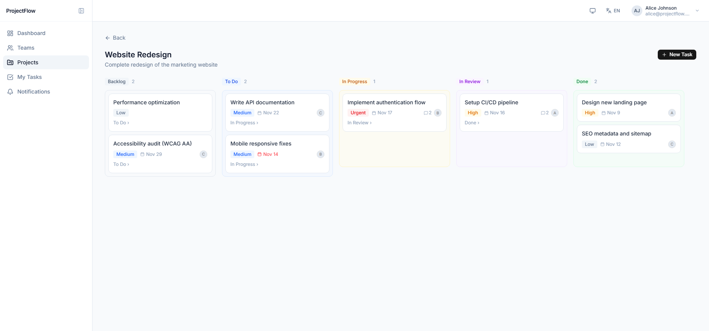
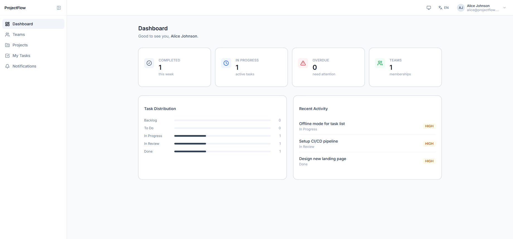
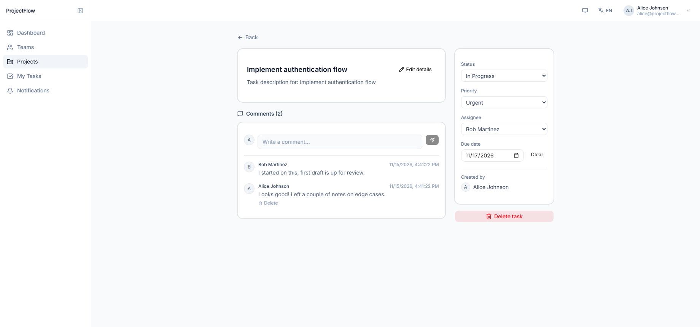
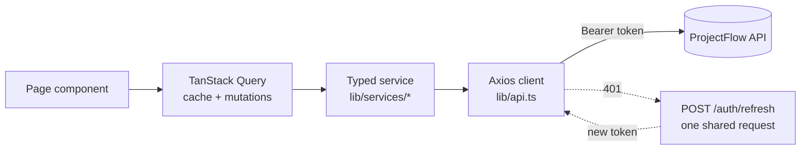

# ProjectFlow Web

[](https://github.com/juanjosegl/projectflow-web/actions/workflows/ci.yml)


Web client for **ProjectFlow**, a team task manager with kanban boards, role-based permissions, email invitations, comments and notifications.

| | |
| --- | --- |
| **Live demo** | **https://projectflow-web-rho.vercel.app** |
| **API repo** | [projectflow-api](https://github.com/juanjosegl/projectflow-api) (NestJS, PostgreSQL) |
| **API docs** | https://projectflow-api-iyet.onrender.com/api/docs |

Click **Open the live demo** to sign in as the admin of a ready-made team. You don't need an account. The demo data resets itself, so feel free to move things around. The first load can take up to a minute while the free API instance wakes up.



| Dashboard | Task detail |
| --- | --- |
|  |  |

## Features

- **Kanban board** with drag and drop between Backlog, To do, In progress, In review and Done. Moves are optimistic and roll back if the server refuses them. Each card also has a "move to next column" button, so the board works with the keyboard and on touch screens.
- **Tasks**: priority, assignee, due date with overdue highlighting, inline editing and comments.
- **Teams**: invite by email, accept or decline invitations, change roles, remove members, leave a team, team progress.
- **Dashboard**: personal workload by status, overdue tasks and tasks completed this week.
- **Notifications** when work is assigned to you, changes status or gets a comment. Each one links to its task.
- **Auth**: email and password or Google, with a short-lived access token that refreshes silently.
- **Light and dark theme** and **English and Spanish**, both remembered.

## Tech stack

| Concern | Choice |
| --- | --- |
| Framework | Next.js 16 (App Router), React 19, TypeScript (strict) |
| Server state | TanStack Query: caching, invalidation, optimistic updates |
| Client state | Zustand (session user, UI preferences) |
| Forms | React Hook Form + Zod |
| UI | Tailwind CSS 4, shadcn/ui on Base UI, lucide icons, Sonner toasts |
| i18n | next-intl (en, es) |
| HTTP | Axios with a refresh-token interceptor |
| Testing | Playwright end-to-end test against the real API |

## How it works



- **Data fetching**: pages never call Axios directly. They use TanStack Query hooks backed by small typed services (`teamsService`, `tasksService`, …). Mutations invalidate exactly the queries they affect, and board moves update the cache optimistically.
- **Sessions**: the API returns a 15-minute access token and sets the refresh token in an `httpOnly` cookie, so JavaScript never sees it. When a request gets a `401`, the Axios interceptor refreshes once and retries. Concurrent `401`s share a single refresh request, because the refresh token rotates on every use and parallel refreshes would invalidate each other.
- **Route protection**: authenticated pages wait for the persisted session to load before deciding to redirect, so a page reload never bounces you to `/login`.
- **Google sign-in** returns the access token in the URL fragment, which is never sent to any server. The callback page reads it once and removes it from the browser history.

## Project structure

```
src/
  app/            routes: landing, login/register, auth callback, dashboard, teams, projects/[id] (board),
                  tasks, notifications, invitations/[token], profile
  components/     ui (shadcn), layout (sidebar, topbar), shared, landing
  lib/            api.ts (Axios + refresh), services/ (typed API calls), providers (Query, theme, toasts)
  store/          auth and UI state (Zustand, persisted)
  hooks/          route guards and demo sign-in
  types/          API types
messages/         en.json, es.json
e2e/              Playwright tests
```

## Getting started

**Requirements:** Node.js 20+, pnpm 10+, and the [API](https://github.com/juanjosegl/projectflow-api) running locally.

```bash
cp .env.example .env.local   # NEXT_PUBLIC_API_URL=http://localhost:3001/api/v1
pnpm install
pnpm dev                     # http://localhost:3000
```

| Script | What it does |
| --- | --- |
| `pnpm dev` | Development server |
| `pnpm build` / `pnpm start` | Production build and server |
| `pnpm lint` / `pnpm typecheck` | ESLint (Next.js rules) and TypeScript |
| `pnpm test:e2e` | Playwright end-to-end test |

## Testing

`e2e/demo.spec.ts` (Playwright) signs in through the demo button, creates a task, moves it to *In progress*, opens it and deletes it. CI runs it on every push against the real API and a seeded PostgreSQL. To run it locally, start the API first, then:

```bash
pnpm build
pnpm exec playwright install chromium
pnpm test:e2e
```

To run it against a deployed site instead, set `BASE_URL`, for example `BASE_URL=https://projectflow-web-rho.vercel.app pnpm test:e2e`. The test deletes the task it creates.

CI also runs the type check, lint and production build on every push and pull request.

## Deployment

Deployed on Vercel from `main`. The only environment variable is `NEXT_PUBLIC_API_URL` (the API base URL, ending in `/api/v1`).

## Known limitations and next steps

- **The access token is kept in `localStorage`**, so it survives reloads without a refresh round trip. Keeping it in memory would shrink the XSS window, but the web app and the API are on different sites, and browsers that block third-party cookies (Safari) would then lose the session on every reload. A shared custom domain would allow both.
- **No component or unit tests yet.** Coverage today is the end-to-end flow. Component tests for the board and the forms (Vitest + Testing Library) are the next step.

## License

[MIT](LICENSE)
